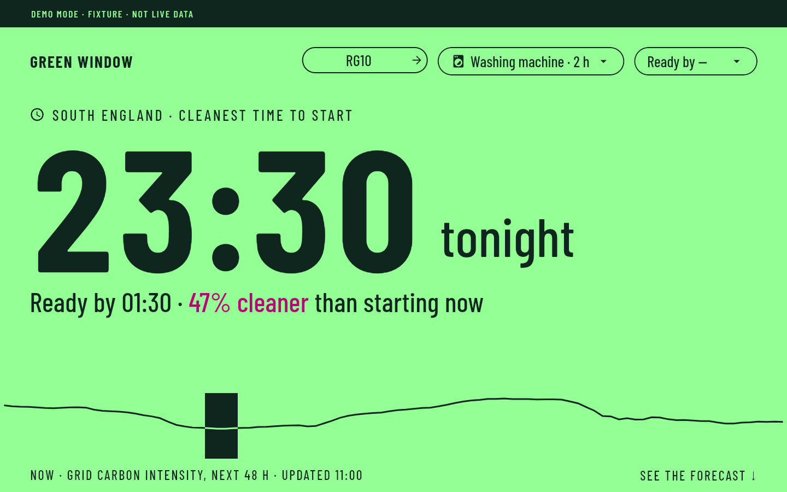
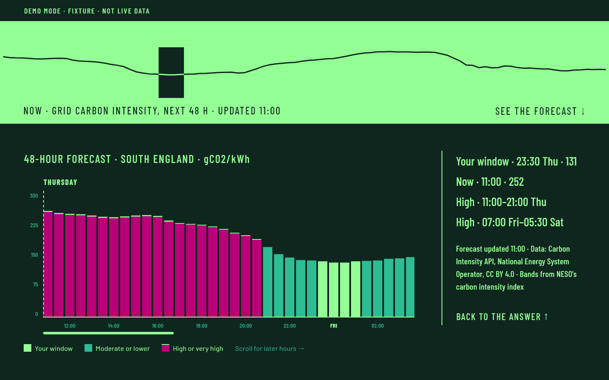
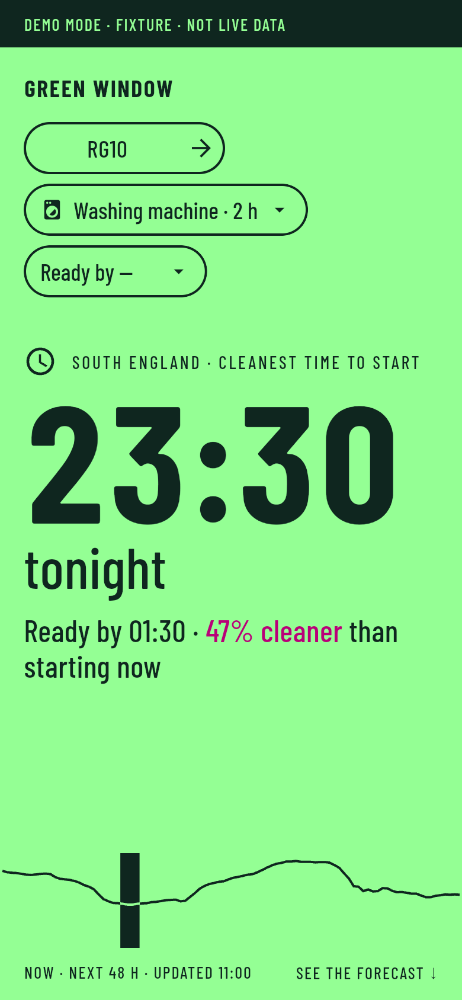
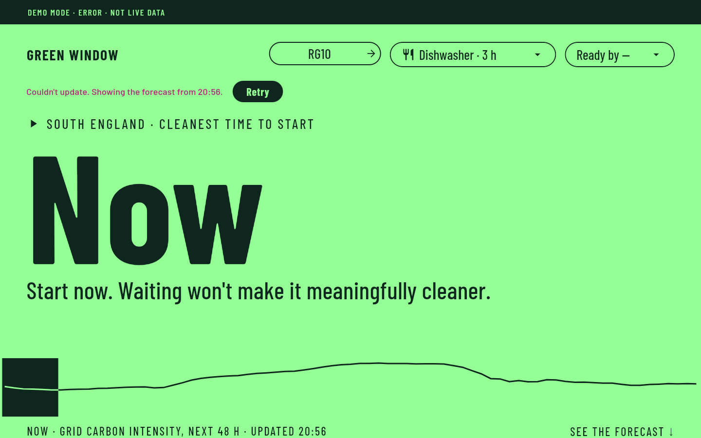

# Green Window

Green Window tells you when to start an appliance so that it runs on the cleanest electricity in your part of the GB grid, and still finishes by the time you need it.

**Live:** [zachmattopo.github.io/green-window](https://zachmattopo.github.io/green-window/) · **Demo with saved data:** [`?demo=fixture`](https://zachmattopo.github.io/green-window/?demo=fixture)



You enter a postcode, pick an appliance and, optionally, a "ready by" time. The module gives one answer, for example *"Start at 23:30 tonight. Ready by 01:30. 47% cleaner than starting now."* The 48-hour forecast for your region sits below the fold, with your window marked on it.

| Below the fold | Mobile | API down, last good forecast shown |
|---|---|---|
|  |  |  |

## Track and API

I took the brief's "bring your own API" route and chose the [Carbon Intensity API](https://carbonintensity.org.uk/) (specifically this [GET API](https://carbon-intensity.github.io/api-definitions/#get-regional-intensity-from-fw48h-postcode-postcode)) from the National Energy System Operator (NESO). It is free, keyless, CORS-enabled and official, and it returns a 48-hour, half-hourly forecast for a region from an outward postcode. In spirit it is closest to Track 01: a live module about a physical system that changes by the hour.

I chose it for three reasons:
- **The data supports a real decision.** On 25 Nov 2026 the national forecast for the next 48 hours ranged from 64 to 192 gCO2/kWh, while South Wales read 374 and South Scotland 0 at the same moment. The time you run a washing machine makes a real difference, but nobody does that arithmetic themselves.
- **There is a clear gap to fill.** The API's own homepage embeds a widget that answers "when is the grid greenest?" for the country as a whole, in fixed 2-hour blocks. Green Window answers a narrower question: when should I start *this* appliance, *here*, so it is ready when I need it? It uses your region, the appliance's run time, any half-hour start, an optional deadline and the full 48 hours, and it tells you when waiting is not worth it.
- **It has real-world quirks to handle.** An unknown postcode returns HTTP 200 with `null` rather than a 400. Slots can be missing. The Isle of Man returns North West England's forecast. Clock changes make "ready by 01:30" ambiguous twice a year.

Before settling on it I compared the brief's three tracks and ran the shortlist past five AI "advisors" (see the [AI usage log](docs/AI_LOG.md)). The full spec is in [docs/PRD.md](docs/PRD.md), and the phased build is in [docs/IMPLEMENTATION_PLAN.md](docs/IMPLEMENTATION_PLAN.md).

## Run it

Flutter is pinned to 3.50.1 with [fvm](https://fvm.app) (`.fvmrc`), so every machine and CI build with the same SDK.

```bash
fvm install
fvm flutter pub get
fvm flutter run -d chrome --wasm
```

Add `?demo=fixture` (or another mode below) to the URL to run without the live API. To serve a release build the same way GitHub Pages does:

```bash
fvm flutter build web --wasm --release
python3 -m http.server 8080 -d build/web
```

Every build and run needs `--wasm`, because Flutter 3.50.1 has no project-level setting for it. GitHub Pages cannot send the COOP/COEP headers that multi-threaded Wasm needs, so the app runs on Wasm in single-threaded mode; for one module, that is plenty. Browsers without WasmGC fall back to the JavaScript build automatically.

### Demo modes

`?demo=` swaps out the network layer, so each failure can be shown on demand. A banner names the active mode, so it cannot be mistaken for live data.

| Mode | What it does |
|---|---|
| `fixture` | Serves a saved real RG10 forecast for any postcode and freezes the clock at 11:00 on Thu 26 Nov 2026. It uses its own storage keys, so it never touches the live cache. |
| `slow` | Delays the **first** request by 12 s, so it times out at 10 s. Later requests go to the live API. |
| `busy` | HTTP 429 |
| `error` | HTTP 500 |
| `garbled` | Invalid JSON |
| `offline` | A network error |

## Test it

```bash
fvm dart format .
fvm dart analyze --fatal-infos
fvm flutter test
```

CI ([`.github/workflows/ci.yml`](.github/workflows/ci.yml)) runs the same checks, plus `flutter build web --wasm`, on every PR and every push to `main`. Each push to `main` also deploys to GitHub Pages ([`deploy.yml`](.github/workflows/deploy.yml)).

## Architecture

```
lib/
  main.dart            timezone data, demo mode, wiring, runApp
  src/
    domain/            pure Dart: no Flutter, no I/O
      postcode.dart        outward code → sealed PostcodeResult
      london_time.dart     UTC → Europe/London, day labels, next "ready by"
      window_finder.dart   findGreenWindow(...) → sealed WindowOutcome
    data/
      carbon_intensity_client.dart   GET, 10 s timeout, retries, status → failure
      forecast_parser.dart           tolerant JSON → Forecast
      forecast_cache.dart            last good forecast per area, last inputs
      forecast_repository.dart       client + cache
      demo/demo_client.dart          the ?demo= clients
    ui/
      green_window_cubit.dart, green_window_state.dart
      green_window_module.dart, theme.dart, widgets/
test/                  mirrors lib/src/
```

Data flows one way: UI → Cubit → Repository → Client and Cache. The Cubit runs the pure `findGreenWindow` on the forecast it already holds, so changing the appliance or the ready-by time recalculates the answer without a new request. Dependencies are passed in through constructors and wired together in `main.dart`.

| Package | Why I chose it |
|---|---|
| `flutter_bloc` | A single Cubit gives explicit states without the events a full Bloc would need, which suits one screen and is easy to explain. |
| `http` | There is one GET endpoint. Its `MockClient` also powers every demo mode. |
| `shared_preferences` | Keeps the last good forecast per area and the last inputs in browser storage. |
| `timezone` | Converts to Europe/London explicitly; Dart's `DateTime` only knows UTC and the browser's own zone. I use the 10-year data set (67 KB, against 258 KB for the full one). |
| `fl_chart` | Draws the hero line and the 48-hour bar chart. |
| `reel_text`, `morphnext` | Roll the start time and day word, and morph the appliance and outcome icons. Both snap into place under reduced motion. |

I left some packages out on purpose. get_it and injectable are not needed for one screen, where constructors are enough. freezed and json_serializable would add a build step for what sealed classes and a short hand-written parser already cover. dio is more than one GET needs, there is no navigation for go_router to handle, and I avoided `clock` for the reason below.

## Decisions and trade-offs

- **Time is passed in, never read globally.** Domain functions take `now` as a parameter, and the Cubit takes a `DateTime Function() now`, which lets `?demo=fixture` freeze the clock. I did not use `clock` and `withClock` because they rely on Dart zones: if Flutter's binding starts outside the zone, tap and frame callbacks read the real time and the demo breaks without any error. Every time on screen is converted to Europe/London explicitly, never with `toLocal()`.
- **The module never recommends a time it cannot honour.** A window never spans a gap in the data, never runs past the end of the forecast, and must finish by the deadline.
- **It says so when waiting is not worth it.** If the best window is less than 10% or less than 10 gCO2/kWh cleaner than starting now, the answer is "Start now. Waiting won't make it meaningfully cleaner." The copy says "cleaner" and never "you'll save X kg", because the forecast is the grid's average intensity rather than the marginal emissions of your appliance.
- **Failures are handled per PRD §10.** A request times out after 10 s with no retry, since retrying could keep someone waiting for up to 33 s. Network errors and 5xx responses are retried twice (after 1 s, then 2 s), and each failure has its own message.
- **A stale answer is better than none.** The last good forecast for each area is cached and shown straight away, marked "Updating…" while it refreshes, or "Couldn't update. Showing the forecast from {time}." if the refresh fails. The cache stores the raw API body and parses it again on read, so a corrupt entry simply becomes a cache miss.
- **The latest request wins.** Each load gets an id and stale completions are dropped, so a slow first search cannot overwrite a second one.
- **The answer stays current.** A one-minute timer and returning to the tab both trigger a recalculation, so a start time that has already passed is never shown. A forecast older than 30 minutes is fetched again.
- **Northern Ireland, the Channel Islands and the Isle of Man are blocked before any request.** The API returns null for BT, GY and JE, and North West England's forecast for IM, which would give the wrong advice.

## Testing and QA

### Automated: two unit tests

The brief asks for a few meaningful tests rather than coverage numbers, so I wrote two, one for each way this module could do real damage in production:

1. **[`window_finder_test.dart`](test/src/domain/window_finder_test.dart) guards against wrong advice.** If `findGreenWindow` breaks, people run appliances at the wrong time and nothing on screen looks wrong. It is a table of small hand-built forecasts, with one row for each case where a bug would give a wrong time: gaps, deadlines, the finish of the "now" window, Not enough time, No forecast, no baseline, a flat day, the "tonight" label, and both clock-change days. The frozen fixture clock cannot reach the last two by hand.
2. **[`forecast_parser_test.dart`](test/src/data/forecast_parser_test.dart) guards against a bad payload.** If the parser breaks, one odd response takes the module down for every user. It covers a garbled body, a `null` body, partly bad slots, an unknown intensity band, and the saved fixture parsed in full.

Everything else (retries, caching, races, UI states, copy, the chart and the demo modes) is checked by hand with the plan below. Turning those checks into automated tests is the first thing I would do next.

### Manual test plan

Run these on the hosted build. `?demo=fixture` gives any postcode the RG10 forecast at 11:00 on Thu 26 Nov 2026. To make the cached forecast old without waiting 30 minutes, set `forecast.RG10.at` in DevTools → Local Storage to an earlier time (in milliseconds).

- **Postcodes:** `rg10 9xy` works. `hello`, `BT1 1AA` and `IM1` each show their own message without sending a request. `ZZ9 9ZZ` (live) says the area could not be found. Only the outward code appears in the request URL.
- **Answers** (`?demo=fixture`): RG10 gives "23:30 tonight, 47% cleaner". Ready by 12:00 gives Not enough time, and "Plan for 12:00 tomorrow" then gives a Wait. Changing the appliance or the ready-by time sends no new request.
- **States:** reloading restores the inputs and the answer. `?demo=slow` with a new area shows the loading state. With an old cache, `?demo=slow` shows "Updating…" and then "Couldn't update" after 10 s, and `?demo=error` shows the cached answer with Retry.
- **Failures:** `?demo=error`, `busy`, `garbled` and `offline` each show their own message with Retry. In `?demo=slow`, a second search made straight away wins and is not replaced by the first.
- **Layout and access:** "See the forecast" shows the chart, the layout holds at 390 × 844, Enter submits, and Tab moves through the inputs.

## Known limitations

- **Appliance run times are fixed presets** (washing machine 2 h, dishwasher 3 h, tumble dryer 1 h 30 min, EV top-up 4 h), based on typical eco-cycle lengths. Custom durations are not supported.
- **The forecast is average intensity.** The API forecasts the average carbon intensity of the regional grid, so the "% cleaner" figure describes the grid rather than the emissions your appliance would cause.
- **The region comes from the outward code.** The API maps each outward code to one of 14 regions, so an area near a regional boundary gets its whole region's forecast.
- **There are only two automated tests.** Retries, caching, races and UI states are checked by hand, and the autumn clock-change case for "Plan for tomorrow" was checked once with a throwaway test that is not committed.
- **It has only been checked in Chromium, Safari, and reduced motion.** Firefox and VoiceOver still need a run.
- **The cache is never evicted.** It keeps one entry per area searched, about 35 KB each, in browser storage.
- **The demo modes reach only some states.** The fixture gives a Wait, or Not enough time with a deadline, so Start now and No forecast are shown by the unit test rather than by hand.

## With more time

1. **Widget tests for each PRD §9 state**, driven by the existing `?demo=` clients (they are already `MockClient`s), plus Cubit tests for latest-request-wins and stale-on-failure. This would move most of the manual plan into CI.
2. **Commit the autumn clock-change test** for "Plan for tomorrow".
3. **A browser smoke test in CI** that loads the release Wasm build under `/green-window/` in each demo mode, including Safari and Firefox.
4. **Show the generation mix.** Every slot in the API response already carries a `generationmix` (gas, wind, solar, nuclear and so on), which the parser currently ignores. Showing it for the recommended window would explain *why* that window is cleaner, for example more wind and less gas than right now.
5. **A drying-day overlay with [Open-Meteo](https://open-meteo.com/).** It is free and keyless too. For the tumble dryer and the washing machine, the current and forecast weather could suggest drying the laundry outside instead, which beats any grid window.
6. **Cache eviction** for areas that have not been used in a while.

## AI usage

I used Claude Code throughout the project: to shortlist and probe APIs, to test the idea against an "LLM council", to draft the PRD and plan, to write most of the code phase by phase, and to review its own work. [docs/AI_LOG.md](docs/AI_LOG.md) has one entry per PR, covering what AI produced and what I changed or rejected, and why. A few examples:

- I cut the AI-drafted test plan, which tested almost every rule, down to the two tests above, in line with the brief.
- I set aside my usual production stack (get_it, injectable, freezed, drift) as too heavy for one module.
- Self-reviews caught real bugs before merge: an earliest finish that ignored gaps, an empty response that would have replaced a good cached forecast, and a result that screen readers would have read out every minute.
- I checked every API behaviour the code relies on against the live API first, including the `null` body for unknown areas, the unrounded `from` time and the intensity bands.

## Credits

Data: [Carbon Intensity API](https://carbonintensity.org.uk/), National Energy System Operator, CC BY 4.0.

Fonts: Barlow and Barlow Condensed (SIL Open Font License, `assets/fonts/OFL.txt`).

Colour: Sanzo Wada, *A Dictionary of Color Combinations*, no. 271.
